# GroupFund — Nền tảng quản lý quỹ nhóm minh bạch

**Quản lý thành viên · Theo dõi dòng tiền · Đề xuất & biểu quyết · Minh bạch trách nhiệm giữ quỹ**

Ứng dụng web được xây dựng trong khuôn khổ học phần **Phương pháp phát triển phần mềm hướng đối tượng**.

[](https://www.oracle.com/java/)
[](https://spring.io/projects/spring-boot)
[](https://react.dev/)
[](https://www.typescriptlang.org/)
[](https://www.postgresql.org/)
[](https://www.keycloak.org/)

**Repository:** https://github.com/phuc05112005/group_fund

</div>

---

## 1. Giới thiệu

**GroupFund** là nền tảng web hỗ trợ các nhóm nhỏ và vừa quản lý nguồn quỹ chung một cách có tổ chức, minh bạch và có thể truy vết. Hệ thống tập trung thông tin thành viên, vai trò, khoản đóng góp, khoản chi, đề xuất, biểu quyết, số dư và nhật ký giao dịch trong cùng một ứng dụng.

Đề tài xuất phát từ thực tế nhiều nhóm đang quản lý quỹ bằng bảng tính và tin nhắn riêng lẻ. Cách làm này gây khó khăn khi tổng hợp đóng góp, kiểm soát quyền hạn, xác nhận khoản chi và đối chiếu trách nhiệm của người giữ tiền.

### Điểm nghiệp vụ quan trọng

GroupFund phân biệt rõ ba loại số liệu tài chính, không gộp thành một số dư duy nhất:

| Loại số liệu              | Ý nghĩa                                                                  |
| ------------------------- | ------------------------------------------------------------------------ |
| **Số dư quỹ**             | Tiền thuộc quỹ chung của nhóm.                                           |
| **Tiền thủ quỹ đang giữ** | Số tiền từng Thủ quỹ đang chịu trách nhiệm quản lý để thực hiện chi trả. |
| **Số dư cá nhân**         | Số liệu ghi nhận cho từng thành viên theo nghiệp vụ phân bổ của nhóm.    |

Đây là nguyên tắc nghiệp vụ xuyên suốt các luồng nộp tiền, rút quỹ, chi tiền và bàn giao quỹ.

> **Phạm vi:** Đây là sản phẩm học tập và thử nghiệm. Tích hợp thanh toán sử dụng **VNPay Sandbox**, không xử lý giao dịch ngân hàng hoặc tiền thật và chưa phải hệ thống tài chính vận hành production.

## 2. Mục tiêu và phạm vi

- Vận dụng phương pháp phân tích và thiết kế hướng đối tượng (OOAD), mô hình hóa hệ thống bằng UML.
- Quản lý tài khoản, nhóm quỹ, thành viên và vai trò theo từng nhóm.
- Hỗ trợ nộp tiền, rút quỹ, tạo khoản chi và xác nhận nhận tiền.
- Hỗ trợ tạo đề xuất thu/chi và biểu quyết theo quy tắc nhóm.
- Theo dõi riêng số dư quỹ, tiền thủ quỹ đang giữ và số dư cá nhân.
- Cung cấp nhật ký giao dịch, chi tiết giao dịch và thông báo.

**Ngoài phạm vi:** kế toán doanh nghiệp, quyết toán thuế, đầu tư, tín dụng, cho vay và thanh toán ngân hàng thực tế.

## 3. Công nghệ sử dụng

| Thành phần            | Công nghệ                                                                                         |
| --------------------- | ------------------------------------------------------------------------------------------------- |
| Frontend              | React 19, TypeScript, Vite 8, React Router, Axios, Tailwind CSS, Lucide React                     |
| Backend               | Java 21, Spring Boot 4.1.1, Spring Web, Spring Data JPA, Spring Security, Bean Validation, Lombok |
| API                   | REST API, tiền tố `/api/v1`, tài liệu Swagger/OpenAPI                                             |
| Cơ sở dữ liệu         | PostgreSQL 16                                                                                     |
| Xác thực và định danh | Keycloak 24, Keycloak JS, OAuth 2.0 / OpenID Connect, JWT                                         |
| Thanh toán thử nghiệm | VNPay Sandbox, kiểm tra chữ ký HMAC-SHA512                                                        |
| Môi trường dịch vụ    | Docker Compose, Maven, npm                                                                        |

## 4. Kiến trúc tổng thể

Frontend React hoạt động theo mô hình SPA, gọi REST API của backend. Keycloak đảm nhiệm đăng nhập và phát hành JWT; backend xác minh JWT trước khi xử lý các API được bảo vệ. Spring Data JPA truy cập PostgreSQL. Khi nộp tiền, người dùng được chuyển hướng đến VNPay Sandbox và nhận kết quả thanh toán thử nghiệm.

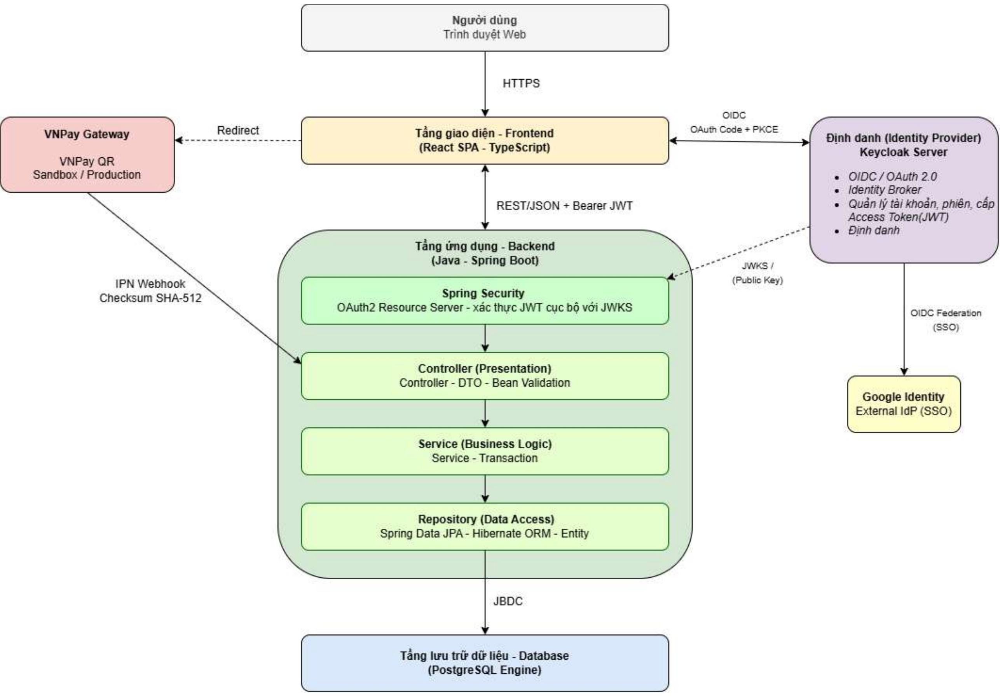

**Các cổng mặc định trong môi trường phát triển:**

| Dịch vụ          | Địa chỉ                                     |
| ---------------- | ------------------------------------------- |
| Frontend Vite    | http://localhost:5173                       |
| Backend REST API | http://localhost:8088/api/v1                |
| Swagger UI       | http://localhost:8088/swagger-ui/index.html |
| Keycloak         | http://localhost:8080                       |
| PostgreSQL       | localhost:5432                              |

## 5. Chức năng chính

### 5.1. Tài khoản và hồ sơ

- Đăng nhập/đăng xuất thông qua Keycloak.
- Đồng bộ hồ sơ người dùng nội bộ khi đăng nhập lần đầu.
- Cập nhật thông tin cá nhân và thông tin tài khoản nhận tiền.

### 5.2. Nhóm quỹ và thành viên

- Tạo nhóm quỹ, sinh mã mời và lựa chọn nhóm công khai/riêng tư.
- Tham gia bằng mã mời; nhóm riêng tư cần quản trị nhóm duyệt yêu cầu.
- Quản lý thành viên, xem số dư và phân vai trò theo từng nhóm.
- Vai trò chính: **Thành viên**, **Quản trị nhóm**, **Thủ quỹ**. Một thành viên có thể đồng thời đảm nhiệm nhiều vai trò trong cùng nhóm.

### 5.3. Đề xuất và biểu quyết

- Tạo đề xuất thu tiền hoặc chi tiền.
- Khai báo nội dung, số tiền và phương án phân bổ.
- Thành viên đủ điều kiện gửi phiếu đồng ý/từ chối.
- Theo dõi trạng thái và tiến trình biểu quyết; người tạo có thể thu hồi đề xuất khi còn hợp lệ.

### 5.4. Nộp tiền và thanh toán thử nghiệm

- Tạo khoản nộp và chuyển hướng đến VNPay Sandbox.
- Backend tạo yêu cầu thanh toán và kiểm tra chữ ký phản hồi.
- Cập nhật trạng thái khoản nộp theo kết quả callback.

### 5.5. Rút quỹ, chi tiền và bàn giao

- Thủ quỹ gửi yêu cầu rút tiền từ số dư quỹ chung.
- Tạo khoản chi, chọn người nhận, phương thức và phương án phân bổ.
- Người nhận xác nhận đã nhận hoặc từ chối khoản chi.
- Backend có các API hỗ trợ bàn giao tiền giữa các thủ quỹ.

### 5.6. Theo dõi và minh bạch

- Theo dõi ba loại số liệu tài chính.
- Tra cứu nhật ký và chi tiết giao dịch.
- Theo dõi thông báo liên quan đến nhóm và giao dịch.

> **Lưu ý về mức độ hoàn thiện:** README mô tả chức năng có trong mã nguồn, không đồng nghĩa mọi nhánh nghiệp vụ đã hoàn thiện đầy đủ. Một số chức năng còn giới hạn hoặc khác với mô hình thiết kế; xem [SYSTEM_OVERVIEW.md](SYSTEM_OVERVIEW.md) để biết phân tích đối chiếu chi tiết và các hạn chế đã ghi nhận.

## 6. Cấu trúc repository

```text
group_fund/
├── backend/                  # Backend Java Spring Boot
│   ├── src/main/java/        # Controller, Service, Repository, Entity, DTO, Config
│   ├── src/main/resources/   # application.yml
│   ├── src/test/             # Kiểm thử
│   ├── pom.xml
│   ├── mvnw
│   └── mvnw.cmd
├── frontend/                 # Frontend React + TypeScript + Vite
│   ├── src/
│   ├── public/
│   ├── package.json
│   └── vite.config.ts
├── keycloak-themes/          # Giao diện tùy chỉnh cho Keycloak
├── docs/
│   └── assets/
│       ├── diagrams/         # Sơ đồ UML, ERD, kiến trúc và triển khai
│       ├── ui-designs/       # Hình thiết kế giao diện
│       └── screenshots/      # Ảnh chụp giao diện sản phẩm
├── docker-compose.yml        # PostgreSQL và Keycloak
├── SYSTEM_OVERVIEW.md        # Tài liệu rà soát mã nguồn và nghiệp vụ
└── README.md
```

## 7. Yêu cầu môi trường

Trước khi cài đặt, cần chuẩn bị:

- Git.
- JDK 21.
- Node.js và npm tương thích với Vite 8.
- Docker Desktop (hoặc Docker Engine) và Docker Compose.
- Trình duyệt web hiện đại.
- Tài khoản/cấu hình VNPay Sandbox nếu muốn kiểm thử luồng thanh toán.

## 8. Cài đặt và chạy chương trình

### Bước 1. Clone repository

```bash
git clone https://github.com/phuc05112005/group_fund.git
cd group_fund
```

### Bước 2. Tạo cấu hình môi trường

Tạo file `.env` ở thư mục gốc từ mẫu `.env.example`, sau đó tự đặt các mật khẩu dùng riêng cho máy cá nhân:

```bash
cp .env.example .env
```

Trên Windows PowerShell có thể dùng:

```powershell
Copy-Item .env.example .env
```

Tạo file `frontend/.env` từ `frontend/.env.example`:

```bash
cp frontend/.env.example frontend/.env
```

**Không commit hai file `.env` này.** Chỉ commit các file `.env.example` không chứa bí mật.

### Bước 3. Khởi động PostgreSQL và Keycloak

```bash
docker compose up -d
```

Kiểm tra trạng thái:

```bash
docker compose ps
```

Xem log khi cần:

```bash
docker compose logs -f postgres
docker compose logs -f keycloak
```

### Bước 4. Chuẩn bị cơ sở dữ liệu

Backend đang cấu hình `spring.jpa.hibernate.ddl-auto: none`, do đó Hibernate **không tự tạo bảng**. Repository hiện cần được bổ sung bản xuất cấu trúc PostgreSQL (schema SQL) từ cơ sở dữ liệu phát triển trước khi một người mới có thể khởi tạo database trống hoàn toàn.

Sau khi có file schema, đặt tại `database/schema.sql` và nạp vào database `group_fund_db`:

```bash
psql -h localhost -p 5432 -U <POSTGRES_USER> -d group_fund_db -f database/schema.sql
```

Không chạy bước này nếu chưa có file schema tương ứng. Không tự suy đoán cấu trúc bảng từ ERD để thay thế bản schema thực tế.

### Bước 5. Cấu hình Keycloak

Mở http://localhost:8080 và đăng nhập bằng thông tin quản trị đã khai báo trong file `.env` cục bộ.

Repository hiện có theme tùy chỉnh tại `keycloak-themes/`, nhưng chưa có file export realm để import tự động. Cần tạo/cấu hình realm theo đúng giá trị mà frontend/backend đang sử dụng:

- Realm: `group-fund-realm`
- Client ID phía frontend: `group-fund-client`
- Frontend URL: `http://localhost:5173`
- Backend issuer: `http://localhost:8080/realms/group-fund-realm`

Cấu hình client theo luồng đăng nhập OIDC Authorization Code + PKCE (S256), khai báo redirect URI và web origin phù hợp với frontend. Nếu sử dụng đăng nhập Google, cấu hình Identity Provider trong Keycloak và tự quản lý Google Client ID/Secret ở môi trường riêng.

### Bước 6. Cấu hình VNPay Sandbox

Khai báo các biến môi trường VNPay trong `.env` cục bộ theo thông tin sandbox được cấp. Không đưa `VNPAY_HASH_SECRET`, tài khoản merchant hoặc dữ liệu xác thực thanh toán lên GitHub.

- Payment URL mặc định: `https://sandbox.vnpayment.vn/paymentv2/vpcpay.html`
- Return URL phát triển: `http://localhost:5173/payment-result`

Chỉ sử dụng thông tin thẻ thử nghiệm do VNPay cung cấp trong môi trường Sandbox. Không dùng thẻ/tài khoản ngân hàng thật.

### Bước 7. Chạy Backend

Mở terminal tại thư mục `backend`:

**Windows:**

```powershell
.\mvnw.cmd spring-boot:run
```

**Linux/macOS:**

```bash
chmod +x mvnw
./mvnw spring-boot:run
```

Backend mặc định chạy tại `http://localhost:8088`.

### Bước 8. Chạy Frontend

Mở terminal khác:

```bash
cd frontend
npm ci
npm run dev
```

Truy cập http://localhost:5173.

### Bước 9. Kiểm tra API

Sau khi backend khởi động thành công, mở:

- Swagger UI: http://localhost:8088/swagger-ui/index.html
- API base path: `http://localhost:8088/api/v1`

### Thứ tự khởi chạy

1. PostgreSQL và Keycloak.
2. Cấu hình database schema và realm Keycloak.
3. Backend Spring Boot.
4. Frontend Vite.
5. Truy cập ứng dụng và đăng nhập.

## 9. Cấu hình môi trường

Các biến quan trọng (giá trị cụ thể được đặt trong `.env` cục bộ, không commit):

| Biến                                                  | Mục đích                         |
| ----------------------------------------------------- | -------------------------------- |
| `POSTGRES_DB`                                         | Database nghiệp vụ               |
| `POSTGRES_USER` / `POSTGRES_PASSWORD`                 | Tài khoản PostgreSQL             |
| `KEYCLOAK_ADMIN_USERNAME` / `KEYCLOAK_ADMIN_PASSWORD` | Tài khoản quản trị Keycloak      |
| `VNPAY_TMN_CODE` / `VNPAY_HASH_SECRET`                | Thông tin merchant VNPay Sandbox |
| `VNPAY_PAY_URL`                                       | URL thanh toán                   |
| `VNPAY_RETURN_URL`                                    | URL trả kết quả về frontend      |
| `VITE_API_BASE_URL`                                   | Địa chỉ REST API frontend gọi    |
| `VITE_KEYCLOAK_URL`                                   | Địa chỉ Keycloak                 |
| `VITE_KEYCLOAK_REALM`                                 | Realm xác thực                   |
| `VITE_KEYCLOAK_CLIENT_ID`                             | Client ID frontend               |

## 10. Tài liệu và sơ đồ

Các sơ đồ được trích xuất từ báo cáo đồ án Word và lưu thành ảnh độc lập để có thể xem trực tiếp trên GitHub.

### Mô hình nghiệp vụ và UML

**Sơ đồ tổ chức vai trò**

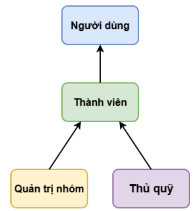

**Use Case tổng quát**

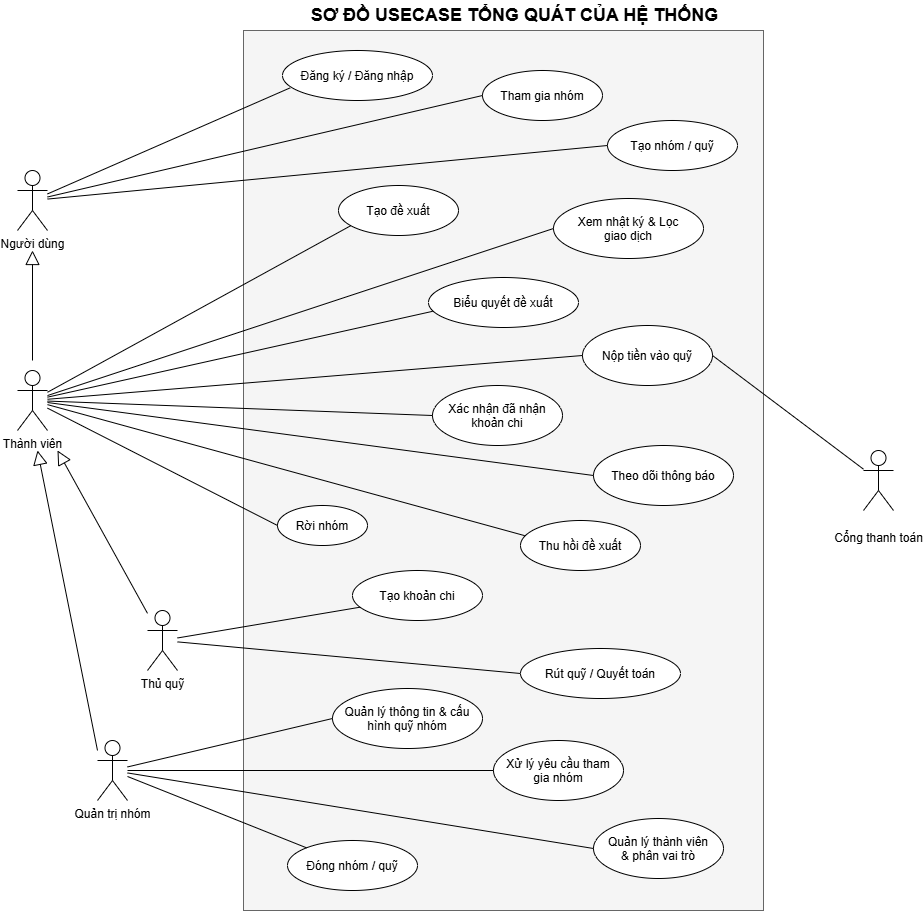

**Sơ đồ lớp phân tích**

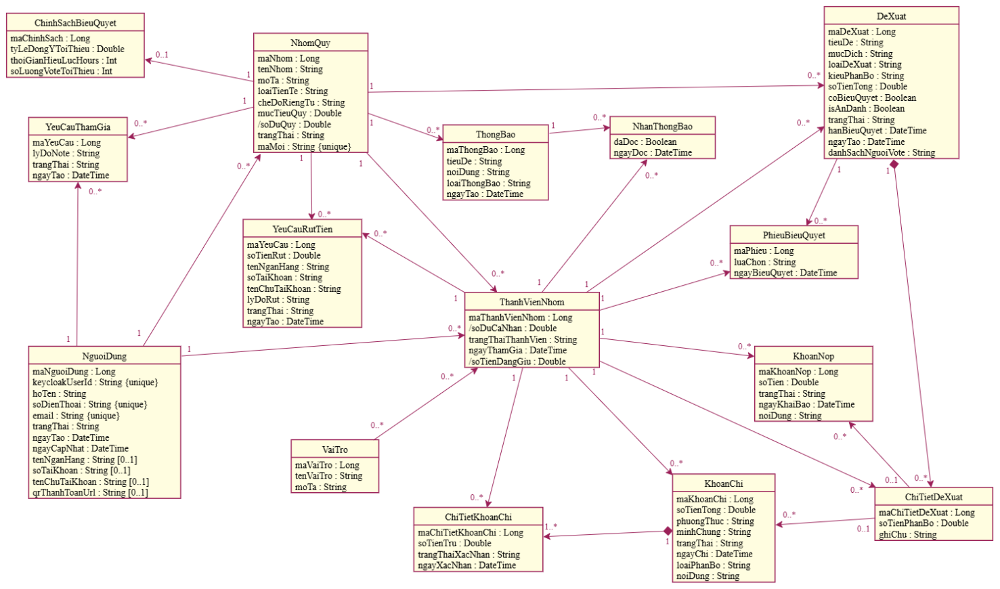

**Sơ đồ trạng thái, tuần tự và hoạt động**

Xem toàn bộ tại thư mục [`docs/assets/diagrams`](docs/assets/diagrams/).

### Thiết kế dữ liệu và kiến trúc

**Sơ đồ ERD**

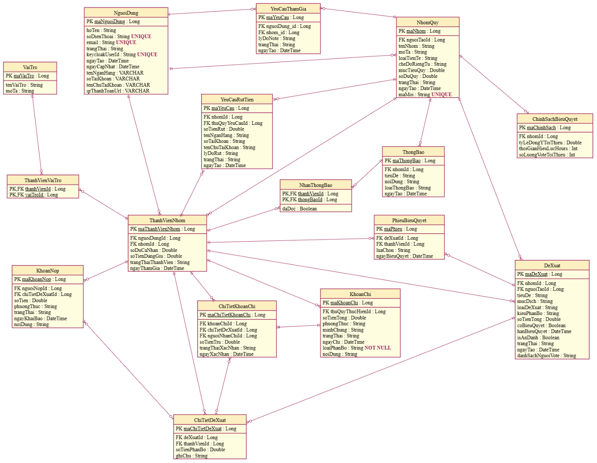

**Kiến trúc tổng thể**


**Sơ đồ triển khai**


### Một số giao diện sản phẩm

**Đăng nhập và tổng quan**

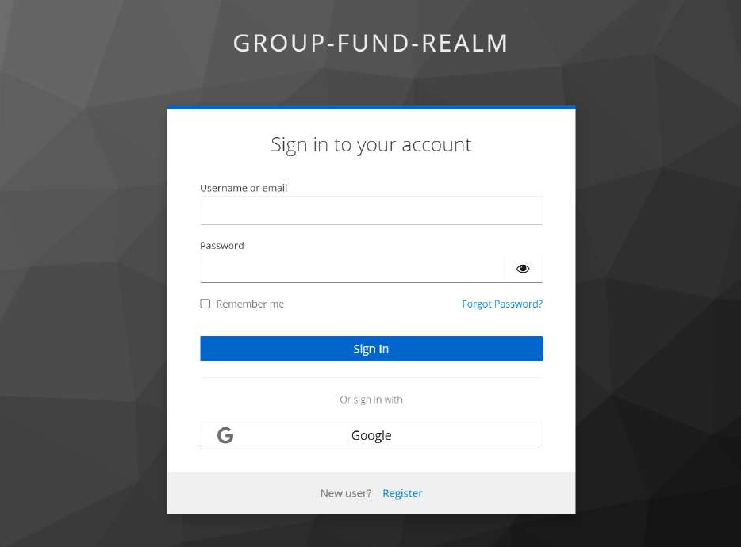

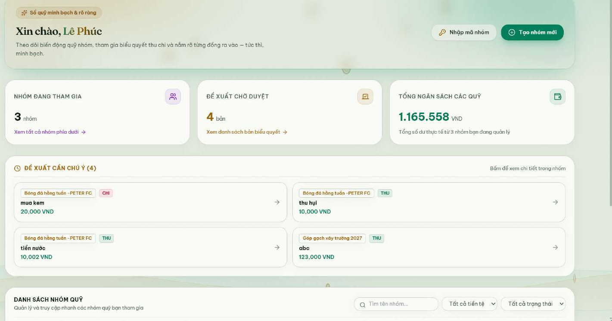

**Nhóm quỹ và thành viên**

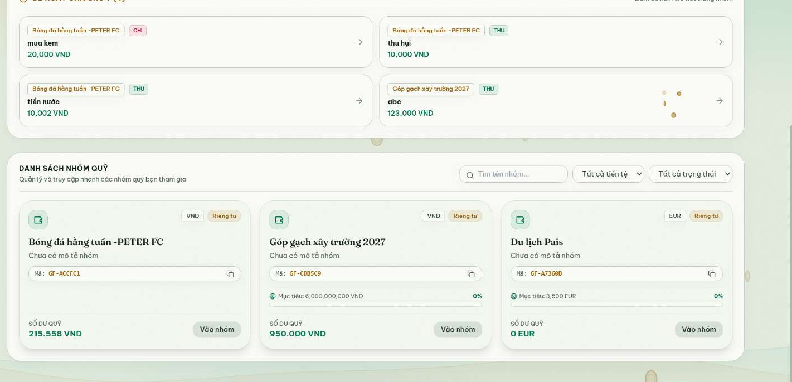

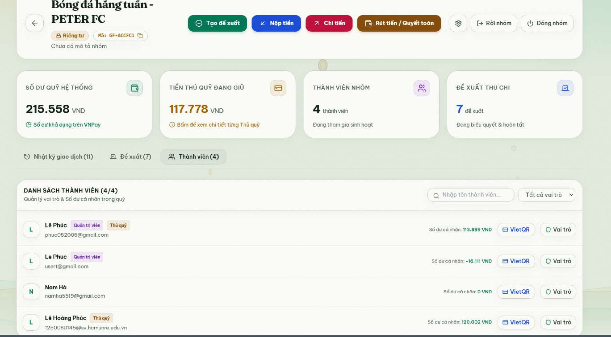

**Đề xuất và biểu quyết**

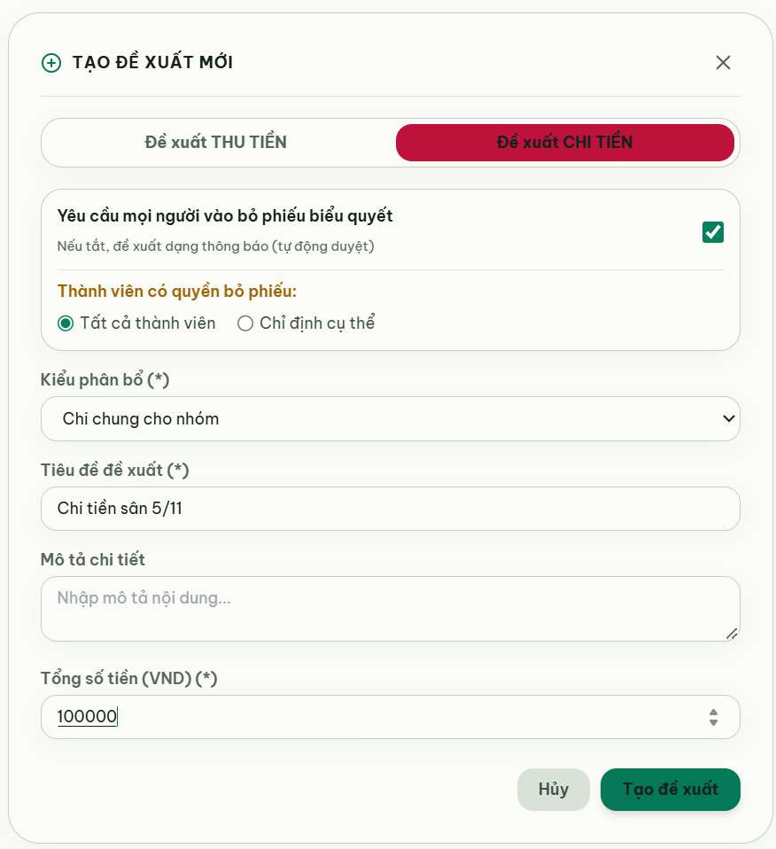

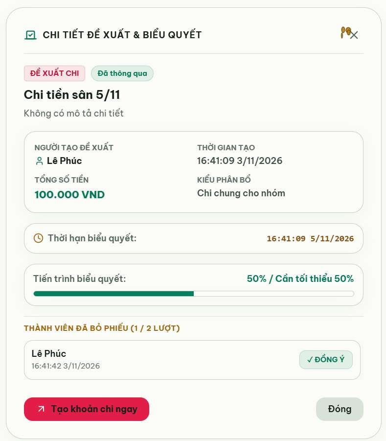

**Nộp tiền, VNPay Sandbox và số dư**

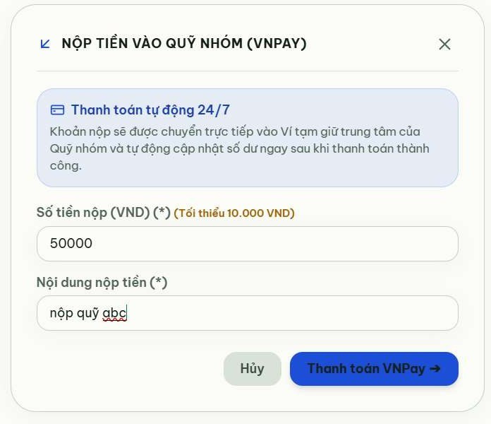

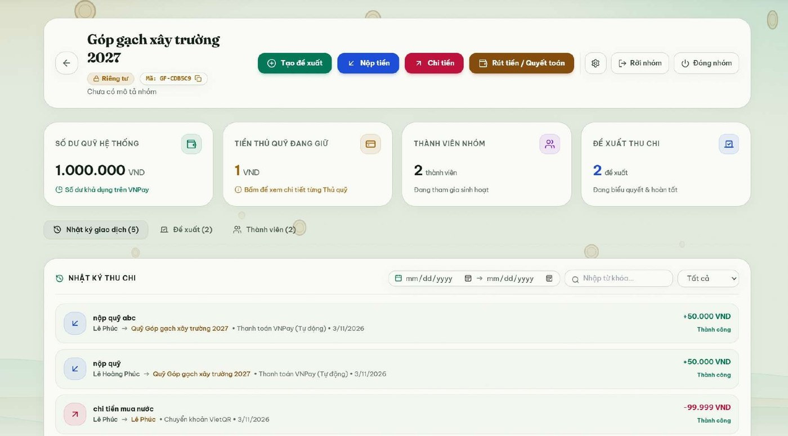

**Rút quỹ và khoản chi**

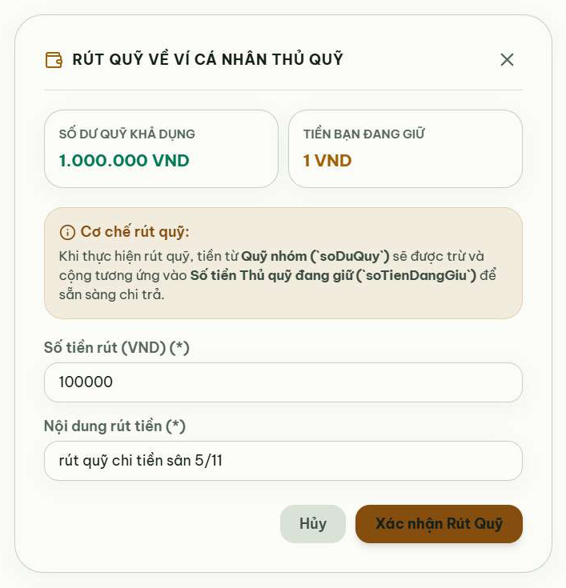

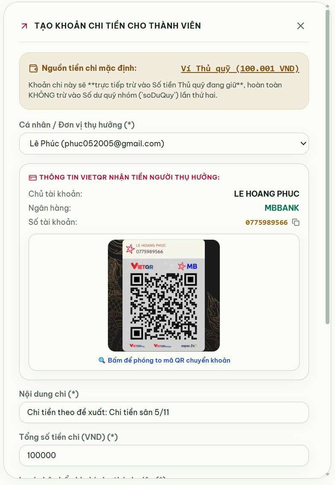

**Nhật ký và thông báo**

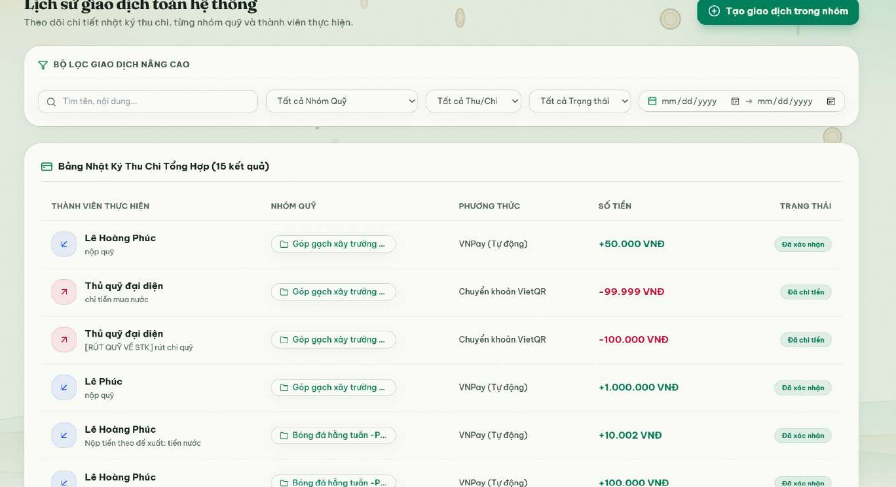

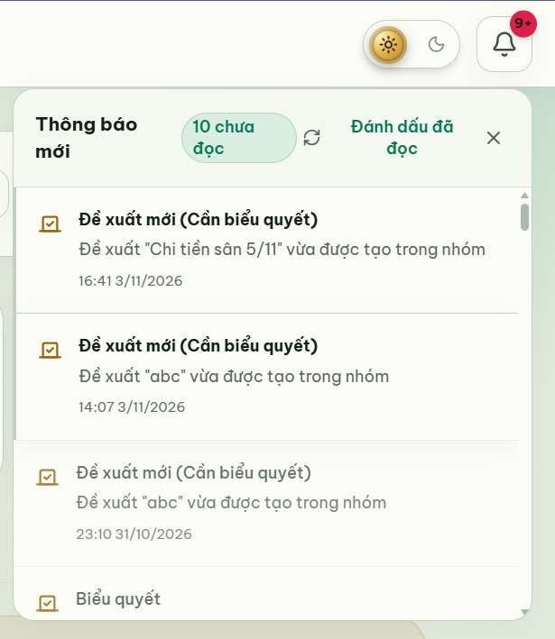

## 11. Kiểm thử và giới hạn hiện tại

Báo cáo đồ án ghi nhận 27 yêu cầu chức năng: 22 yêu cầu hoàn thành và 5 yêu cầu hoàn thành một phần tại thời điểm đánh giá. Một số giới hạn quan trọng:

- Phân quyền backend theo vai trò/nhóm chưa được áp dụng đầy đủ ở tất cả API; ẩn nút trên giao diện không thay thế kiểm tra quyền ở backend.
- Backend đang áp dụng ngưỡng biểu quyết cố định 50% trong khi cấu hình chính sách biểu quyết của nhóm chưa được sử dụng đầy đủ ở phía xử lý.
- Một số dữ liệu dự phòng như phiếu biểu quyết, thông báo hoặc trạng thái đọc có thể lưu trong `localStorage`.
- Một số API có trong backend chưa được frontend tích hợp thành luồng giao diện hoàn chỉnh.
- Rút quỹ hiện được xử lý ngay trong backend, chưa có quy trình đối soát trạng thái nhiều bước như thiết kế.
- Chưa có quy trình xuất sao kê Excel/PDF/CSV và chưa có hệ thống lưu trữ file riêng.
- Chưa có cấu hình production, HTTPS, CI/CD và kiểm thử diện rộng.

Các nội dung trên được nêu để người xem repository phân biệt rõ **phần đã triển khai** và **phần còn là hướng hoàn thiện**, tránh hiểu nhầm sản phẩm thử nghiệm là hệ thống tài chính production.

## 12. An toàn thông tin

- Không commit `.env`, `frontend/.env`, mật khẩu, API key, token, private key hoặc VNPay hash secret.
- Dùng `.env.example` với giá trị minh họa không có quyền truy cập thật.
- Không lưu tài khoản/mật khẩu quản trị mặc định trong source code.
- Không đưa thông tin thẻ ngân hàng thật hoặc dữ liệu cá nhân của người dùng lên repository.
- Nếu bí mật từng được commit lên repository public, cần **thu hồi/thay đổi bí mật ngay**. Xóa khỏi file ở commit mới không xóa được giá trị khỏi lịch sử Git; cần xử lý lịch sử nếu đã lộ thông tin có giá trị sử dụng.
- Trước khi nộp, rà soát toàn bộ repository và lịch sử commit để bảo đảm không còn thông tin nhạy cảm.

## 13. Tác giả và học phần

- **Sinh viên thực hiện:** Lê Hoàng Phúc
- **Đề tài:** Nền tảng quản lý quỹ nhóm minh bạch (GroupFund)
- **Học phần:** Phương pháp phát triển phần mềm hướng đối tượng
- **Giảng viên hướng dẫn:** ThS. Phạm Trọng Huynh
- **Đơn vị:** Khoa Công nghệ thông tin – Trường Đại học Tài nguyên và Môi trường TP. Hồ Chí Minh

---

<div align="center">

**GroupFund — Minh bạch dòng tiền, rõ ràng trách nhiệm, cùng nhau quản lý quỹ.**

</div>
